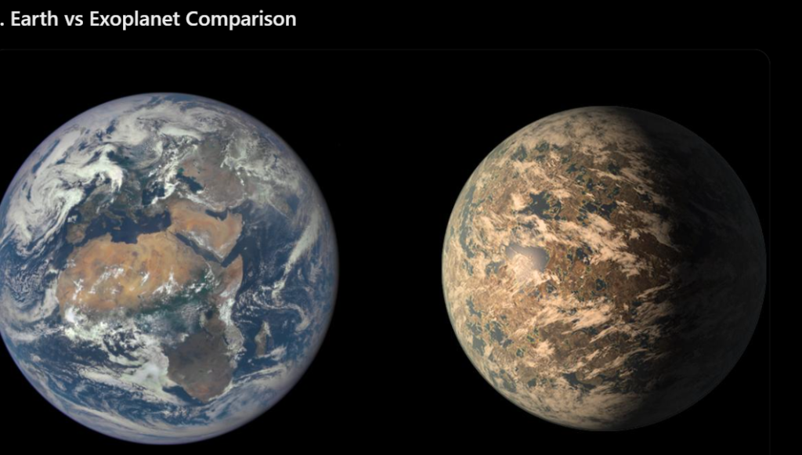
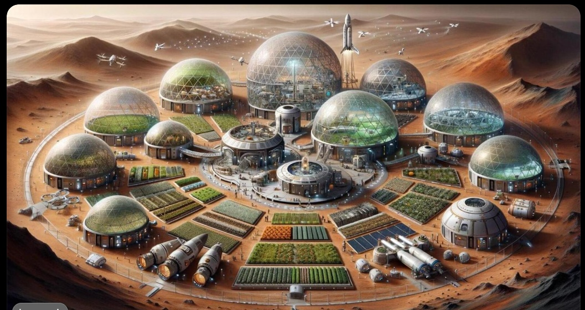
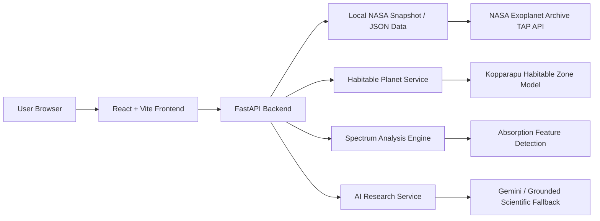

# Orbitron: The New World

<div align="center">

[](https://www.python.org/)
[](https://fastapi.tiangolo.com/)
[](https://react.dev/)
[](https://www.typescriptlang.org/)
[](https://exoplanetarchive.ipac.caltech.edu/)

</div>

<p align="center">
  
</p>

> Beyond Earth. Towards Humanity's Next Home.

Orbitron is a cinematic exoplanet intelligence platform that combines NASA exoplanet telemetry, habitability science, atmospheric spectroscopy, and human radiobiology into a single interactive research experience.

## Why this project matters

Orbitron helps users explore:
- which exoplanets are most promising for habitability analysis,
- how stellar flux and cloud feedback reshape the habitable zone,
- what atmospheric chemistry can be inferred from transmission spectra,
- and how deep-space radiation affects DNA, immunity, and long-duration human survival.

The project blends:
- a FastAPI science backend,
- a React + TypeScript frontend,
- curated NASA archive data,
- a local exoplanet snapshot,
- and grounded AI-assisted scientific reasoning.

### Quick project stats

- Real exoplanet archive dataset coverage
- Habitability and thermal-zone analysis
- AI chat + comparative planetary insight engine
- Space-radiation biology and anatomy modeling
- Mission-control style cinematic UI

---

## Overview

---

## Product Highlights

- Mission control dashboard with live exoplanet telemetry
- Explorer view for filtering and comparing planets by radius, insolation, temperature, and discovery type
- Habitability analysis with Kopparapu and cloud-feedback heuristics
- Anatomy lab for radiation and biological impact modeling
- Spectrum lab for atmospheric absorption detection
- Comparison view for Earth-vs-exoplanet analysis
- AI panel for research summaries and comparative planetary insights

---

## Screenshots and Visuals

### Mission control and planetary dashboard


### Exoplanet comparison and habitability analysis


### Habitat and climate framing



### Anatomy and biomedical science panels


### Additional product panels


---

## Architecture Diagram



---

## Technical File Map

### Data and snapshot generation
- `scripts/fetch_planets.py` downloads composite exoplanet data from the NASA TAP API, filters it for completeness, and writes a local offline snapshot to `data/planets_snapshot.json`.
- `data/planets_snapshot.json` is the main data source for the frontend and contains key fields like `pl_name`, `pl_rade`, `pl_bmasse`, `pl_eqt`, `pl_insol`, `sy_dist`, and stellar parameters.
- `data/habitable_planets_cache.json` stores enriched habitable candidates for faster analysis and local fallback use.
- `data/bio_effects.json` holds biological and radiation impact data for the anatomy and survival modeling layers.

### Backend services
- `backend/main.py` is the FastAPI entry point and API layer for the entire project.
- `backend/nasa_service.py` enriches exoplanets with habitability classification, stability heuristics, stellar risk, and habitable-zone metrics.
- `backend/spectrum_engine.py` analyzes spectral signatures using baseline subtraction, noise estimation, and peak detection to identify likely molecular absorption features.
- `backend/ai_service.py` provides the scientific assistant layer, supporting Gemini-backed answers with a deterministic fallback when no API key is available.

### Frontend application
- `frontend/src/App.tsx` controls navigation, selected planet state, comparison lists, and overall screen flow.
- `frontend/src/pages/` contains each feature page: MissionControl, Explorer, Dossier, AnatomyLab, Comparison, SpectrumLab, Settlement, and About.
- `frontend/src/components/` contains reusable UI features such as nav, drawers, badges, and floating AI panel.
- `frontend/src/lib/` contains habitability, radiation, spectrum, and analytics helpers.
- `frontend/src/types.ts` defines the core exoplanet data model used by the app.

---

## Core Scientific Logic

### 1. Exoplanet data pipeline
The project starts from NASA’s `pscomppars` tables and builds a curated offline snapshot. This gives the app a reproducible, high-quality dataset even without a live NASA connection.

### 2. Habitability modeling
The backend applies:
- Kopparapu et al. habitable-zone boundaries,
- cloud feedback and stellar flux heuristics,
- rocky-world threshold logic based on radius and bulk density assumptions,
- and candidate scoring for “too hot,” “too cold,” or “habitable” categories.

### 3. Spectral analysis
The spectrum engine estimates baseline trends, removes continuum noise, and searches for peaks that align with molecular absorption bands like:
- H2O
- CO2
- CH4
- O3
- NH3
- SO2

### 4. Space biology and human risk
The radiobiology layer models:
- DNA double-strand breaks,
- radiation dose equivalents,
- immune system suppression,
- and nervous-system stress from heavy ion exposure and microgravity.

---

## Tech Stack

- Python 3
- FastAPI
- React
- TypeScript
- Vite
- NASA Exoplanet Archive TAP API
- JSON snapshot-based local caching
- Gemini / grounded scientific fallback LLM integration
- NumPy / SciPy for spectral processing

---

## Local Setup

### Backend
```bash
cd backend
python -m venv .venv
source .venv/bin/activate   # Windows: .venv\Scripts\activate
pip install -r requirements.txt
uvicorn main:app --reload --host 0.0.0.0 --port 8000
```

### Frontend
```bash
cd frontend
npm install
npm run dev
```

Then open:
- Frontend: http://localhost:5173
- API: http://127.0.0.1:8000/api/health

---

## Main API Endpoints

- `GET /api/health` — health probe
- `GET /api/planets` — list/filter planets
- `GET /api/planets/{identifier}` — fetch one planet record
- `GET /api/planets/habitable` — get enriched habitable candidates
- `POST /api/spectrum/analyze` — analyze a transmission spectrum
- `GET /api/spectrum/demo/{preset}` — get demo spectra
- `POST /api/ai/chat` — scientific Q&A
- `POST /api/ai/compare-insights` — comparative planetary reasoning
- `GET /api/nasa/images` — archive image fallback

---

## Research and Data Sources

- NASA Exoplanet Archive
- NASA public image and library resources
- Kopparapu et al. habitable-zone models
- Rogers rocky-world thresholds
- Radiobiology literature on DNA damage, microgravity, and space radiation
- JWST-inspired transmission spectroscopy references

---

## Why Orbitron Matters

This project sits at the intersection of space exploration, planetary science, and human survival beyond Earth. It transforms scientific data into a cinematic narrative that helps researchers, students, and curious users understand how planets are classified, why habitability is complex, and what space radiation means for long-duration human missions.

---

## Project Status

The project includes:
- scientific data ingest,
- enriched astrophysical scoring,
- atmospheric spectroscopy analysis,
- UI-based exploration,
- AI-assisted explanation,
- and a polished visual storytelling experience.

---

## License

This project is intended for research, exploration, and demonstration purposes.

---

## Repository Notes

The project is centered around a reproducible scientific snapshot, local analysis services, and a cinematic user experience designed for research and storytelling in the exoplanet domain.
